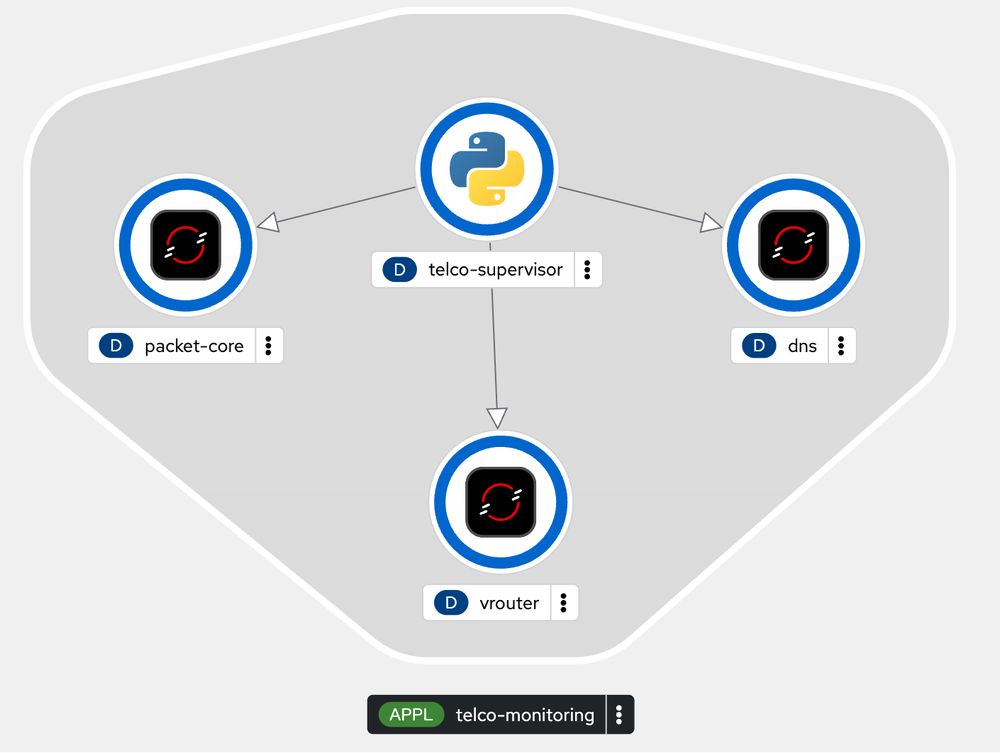

# Telco Service Monitoring on OpenShift

Learning project running three simulated Telco services and a
Python supervisor on an OpenShift sandbox.

## Architecture

The supervisor checks the services over HTTP using cluster DNS:

- http://packet-core:8080/index.html
- http://vrouter:8080/index.html
- http://dns:8080/index.html

Each simulated service has a Deployment, a ClusterIP Service,
a ConfigMap containing its response, and an HTTP readiness probe.

The supervisor displays a Rich table in its logs every cycle.
It reports UP when the endpoint responds with the expected service
name and status, and DOWN when the request or validation fails.

## Scope

Packet Core, vRouter and DNS are HTTP simulators.
They do not implement real network functions or DNS resolution.

## Deployment

Prerequisites: oc, a logged-in OpenShift session, and permissions
to create binary Source-to-Image builds.

Select your project:

    oc project YOUR_PROJECT

Deploy the simulated services:

    oc apply -f packet-core.yaml -f vrouter.yaml -f dns.yaml

Create and run the supervisor image build:

    oc new-build openshift/python:3.12-ubi9 \
      --name=telco-supervisor --binary=true --strategy=source

    oc start-build telco-supervisor \
      --from-dir=supervisor --follow --wait

Before applying supervisor.yaml, replace hassensiad06-dev in its
image reference with your project name.

    oc apply -f supervisor.yaml
    oc rollout status deployment/telco-supervisor
    oc logs deployment/telco-supervisor --follow

## Failure and recovery exercise

Stop the vRouter simulator:

    oc scale deployment/vrouter --replicas=0

Expected observation: vrouter becomes DOWN while packet-core and
dns remain UP. The vrouter Service remains, but has no serving pod.

Restore the simulator:

    oc scale deployment/vrouter --replicas=1
    oc rollout status deployment/vrouter

Expected observation: vrouter returns to UP once the pod is ready.

## Validated in the sandbox

- Image built inside OpenShift without Docker on the workstation.
- Internal HTTP communication using Service DNS names.
- All three simulated services reported UP.
- vRouter outage and recovery detected by the supervisor.

## Limitations

Checks run sequentially with a three-second timeout per service,
followed by a ten-second pause.
Results are displayed in logs, without persistent history or alerts.
The supervisor has no application health probes yet.

## OpenShift topology

Run `./topology.sh` after deploying the four components.

The arrows represent declared dependencies. The supervisor checks
the three simulated services over HTTP using internal Service DNS.

## Supervisor configuration

Before deploying the supervisor, apply its configuration:

    oc apply -f supervisor-config.yaml

The ConfigMap is mounted at /etc/telco/config.json.
The supervisor reloads it at the start of every cycle.

Configurable settings:
- Service names and URLs
- HTTP request timeout
- Pause between monitoring cycles

Changing the ConfigMap requires no image rebuild or pod restart.
Mounted configuration updates propagate asynchronously.

Validated exercise: changed interval_seconds from 10 to 5 and
observed pause=5s in the logs without restarting the supervisor.
